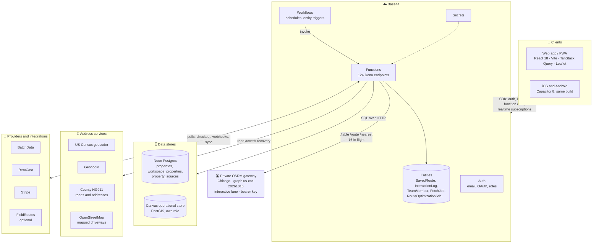
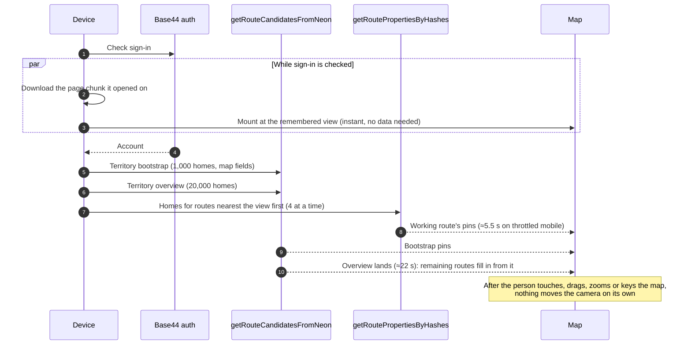
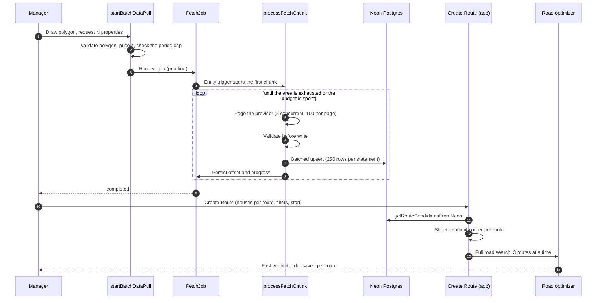
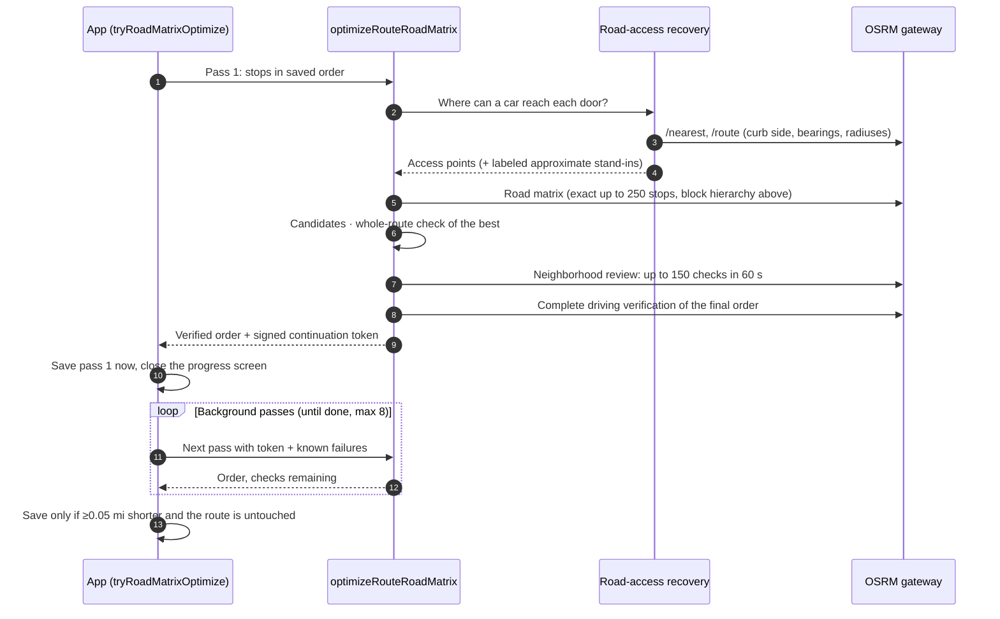
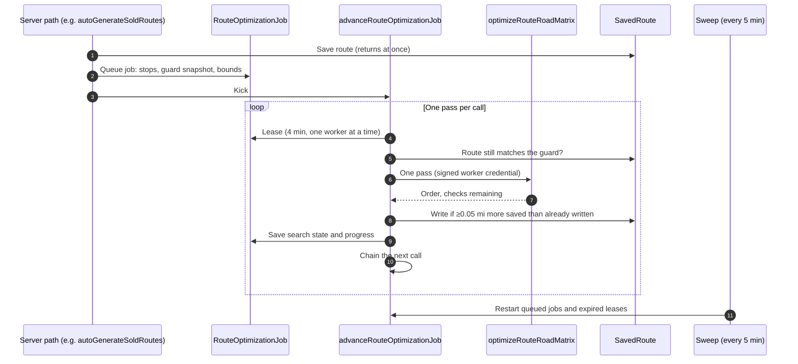
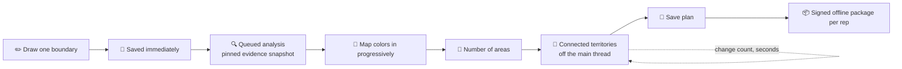

# FirstKnock Sales OS

> **Field intelligence for door-to-door sales teams.**
> Draw a boundary on a map. FirstKnock turns it into real, ownable work: verified sold-home leads on a road-optimized route, or connected residential territories split fairly across a crew. Then it puts that work in every rep's pocket, online or off.

<p align="left">
  
  
  
  
  
  
  
  
  
</p>

**Who it's for:** door-to-door sales organizations, such as solar, pest control, roofing, home services and security. A **manager** builds and assigns the work. A **rep** knocks it from a phone.

**What it does:**

| | |
|---|---|
| 🎯 **Precision lead pulls** | Draw an area. FirstKnock pulls recently sold homes from BatchData and RentCast, verifies each sale before anything is written, and stores the homes in Neon Postgres. |
| 🚗 **Road-optimized routes** | Every route is ordered on real roads by FirstKnock's private OSRM gateway. Each order is checked end to end before it is saved. On the owner's real 1,000-stop routes this cut up to **29%** of the miles. |
| ⚡ **First result fast** | The first verified order is saved in 13–72 s. The rest of the search finishes quietly in the background, and a better result is saved only if nobody touched the route. |
| 🗺️ **Working-area-first map** | The map opens on the area the person works, and that area's pins load first. It never zooms out to "everything" on its own. |
| 🧩 **Bulk route tools** | Split, merge, ZIP, campaign, import and the territory wizard all run every route through the same road search, three at a time. |
| 🖥️ **Server background jobs** | Routes generated on the server, such as daily recent-sales routes or rep anchors, are improved by resumable server jobs while nobody waits. |
| 🗺️ **Canvas territories** | Precompiled OpenStreetMap and Census evidence becomes connected, exclusive territories, delivered to reps as signed offline packages. |
| 📱 **Field app** | Web, installable PWA, and native iOS and Android through Capacitor. Offline route cache, GPS proof of visit, photo capture, time clock and team chat. |
| 💳 **Billing** | Stripe subscriptions, seats and metered Precision credits, reconciled against delivered work. |

---

## Contents

1. [Architecture at a glance](#1-architecture-at-a-glance)
2. [The two generation lanes](#2-the-two-generation-lanes)
3. [How it works](#3-how-it-works)
   - [3.1 App start and map load](#31-app-start-and-map-load)
   - [3.2 Precision: from a drawn area to routes](#32-precision-from-a-drawn-area-to-routes)
   - [3.3 The road optimizer](#33-the-road-optimizer)
   - [3.4 Bulk route flows](#34-bulk-route-flows)
   - [3.5 Server background jobs](#35-server-background-jobs)
   - [3.6 Territory overview](#36-territory-overview)
   - [3.7 Storage: what lives where](#37-storage-what-lives-where)
   - [3.8 Canvas: territory generation](#38-canvas-territory-generation)
   - [3.9 In the field](#39-in-the-field)
4. [Performance](#4-performance)
5. [Repository layout](#5-repository-layout)
6. [Local development](#6-local-development)
7. [Testing and CI](#7-testing-and-ci)
8. [Benchmarks](#8-benchmarks)
9. [Deploying and publishing](#9-deploying-and-publishing)
10. [Configuration and secrets](#10-configuration-and-secrets)
11. [Guardrails](#11-guardrails)
12. [Troubleshooting](#12-troubleshooting)
13. [Reference: functions, entities, workflows](#13-reference-functions-entities-workflows)
14. [Documentation index](#14-documentation-index)

---

## 1. Architecture at a glance



| Layer | What it is | Where |
|---|---|---|
| **Frontend** | React 18 SPA built with Vite. TanStack Query caches server state. Leaflet and react-leaflet draw the map. Pages are lazy-loaded, and the page a signed-in device opened on is fetched while sign-in is still checking. | `src/` |
| **Mobile** | The same build wrapped by Capacitor 8 (`com.firstknock.salesos`). `npm run mobile:build` builds and syncs. | `ios/`, `android/`, `capacitor.config.ts` |
| **Backend** | Base44: auth, entity storage with row-level security, secrets, scheduled and entity-triggered workflows, and 124 Deno functions. Shared server code is imported by functions and, where it is pure, also by the app and the tests. | `base44/functions/*/entry.ts`, `base44/shared/`, `base44/entities/`, `base44/workflows/` |
| **Homes** | Neon Postgres holds every property row and its workspace links. Functions reach it over HTTP with `@neondatabase/serverless`. | `setupNeonPropertyTables`, `getRouteCandidatesFromNeon` |
| **Roads** | A private OSRM gateway (Chicago, US car graph `us-car-20261016`). FirstKnock calls its interactive lane with its own bearer key. Every request goes through one dispatcher that applies the concurrency cap, retries and deadlines. | `base44/shared/osrmProvider.js`, `osrmDispatcher.js` |
| **Addresses** | Census (free) first, then Geocodio (paid). County NG911 road and address services where registered. OpenStreetMap for mapped driveways. Used only to find where a car can reach a door. | `routeAccessRecovery.js`, `censusGeocode.js`, `geocodioGeocode.js`, `countyRoad*.js`, `mappedDrivewayAccess.js` |
| **Property data** | BatchData and RentCast for Precision pulls. Each property is paid for, so each pull is validated, capped and reconciled. | `startBatchDataPull`, `processFetchChunk`, `fetchZipProperties` |
| **Billing** | Stripe Checkout, Customer Portal, webhooks, seats and Precision credits. | `createCheckoutSession`, `stripeWebhook`, `precisionCredits.js` |

---

## 2. The two generation lanes

FirstKnock runs **two independent generation lanes**. They share the map, the roster and billing, and nothing else. A failure in one cannot corrupt the other, and tests enforce that isolation (`test/canvas-precision-isolation.test.mjs`).

|  | 🎯 **Precision** | 🗺️ **Canvas** |
|---|---|---|
| **Answers** | *Which specific homes just sold?* | *How do I split this whole area into fair territories?* |
| **Unit of work** | One verified property | A connected street-side territory |
| **Evidence** | BatchData and RentCast, paid per pull | OpenStreetMap and Census, precompiled |
| **Marginal cost** | Metered per property | Effectively zero once compiled |
| **Output** | A road-optimized route | Exclusive territories, one owner each |
| **Storage** | Neon (homes) and Base44 (`SavedRoute`) | Canvas operational store (PostGIS) |

---

## 3. How it works

### 3.1 App start and map load

The owner's problem was a map that took about 45 s, then snapped out to show every route. Two rules fix it. The map opens on **the area the person works**, and that area's pins load first. It **never moves on its own** after the person touches it.



**Where the camera opens** (`src/lib/accountWorkingArea.js`, first match wins):

1. **The last view this person moved to on this device.** Center and zoom are stored per user under `fk_map_view_v2_<user>`. Only views the person moved to are stored, never an automatic fit, so an old zoomed-out snapshot can't come back.
2. A drawn Precision boundary.
3. **One route:** the active (not completed or archived) one, else the most recent. A rep gets their assigned route, a manager their latest. The camera waits for that one route's pins only.
4. The most recent Precision pull area, then loaded homes (newest ZIP), then the device location.

Seeing every route is an explicit action: the **Show all routes** button. Selecting a route still fits that route. `MapUserIntent` (`src/components/map/MapHelpers.jsx`) marks the first pointer, touch, wheel or key event, and from then on no late-loading data may move the view.

**Which pins load first** (`src/components/logic/routeHydrationCore.js`):

- `routeLocationHint` places a route before its homes load. It uses, in order: its homes already on the device, its saved driving path, the area it was pulled from, then its start.
- `orderRoutesNearView` sorts routes by distance from the map's center, or from the remembered view before the map exists.
- `selectRoutesToHydrate` decides which routes are looked up while the overview is still loading:
  - the 3 nearest routes;
  - the 3 newest;
  - any in-progress route;
  - imported routes, whose homes are never in the overview.

  Everything else renders from overview homes once those land. Only homes the overview lacks are requested afterwards.
- Lookups always carry the route's `route_id`, so the server authorizes each request against that one route's manifest.

### 3.2 Precision: from a drawn area to routes

Precision answers *"which specific homes just sold in this area?"* Every property costs money to verify, so the lane is built around not wasting a call and never writing an unverified record.



**Jobs.** `pending → running → completed | failed | cancelled`. Only `pending` and `running` count as active, which stops duplicate paid pulls on one area.
- One invocation gets a **45-second provider scan budget** and at most **2,500 selected records**. It then persists its offset and chains the next chunk.
- `PipelineLock` (8-minute TTL) keeps two chunks off one job.
- `Resume Stalled Data Pulls` and `Stale FetchJob Watchdog` settle anything that dies mid-flight.

**Cost protection.** Caps are enforced server-side per billing period. The reservation math is persisted on the `FetchJob`, so progress and billing can't drift apart. `getPrecisionUsage`, `recordPrecisionDelivery` and `reconcilePrecisionUsage` keep Stripe and delivered work in step.

**Sold-signal validation (ZIP lane, `fetchZipProperties`).** Three steps run before any record is written:
1. **Two RentCast streams.** County deeds (`sale_confidence: 'high'`) and recently removed MLS listings. A deed wins over an MLS record for the same address.
2. **Heuristic scoring of MLS removals.** Removal on a 90/180/365-day contract boundary, stale or flash listings, and relist churn count against a record. A 14–45-day escrow window and a clean history count for it. Score ≥ 3 is `HEURISTIC_SOLD`. Score ≤ −4 is rejected. Anything in between goes to step 3.
3. **BatchData verification** of ambiguous records: at most 100 calls per chunk, in batches of 10. A record is kept only if BatchData reports it sold.

**Create Route** (`src/lib/roadMatrixRouteGeneration.js`) builds each route's street-continuity order locally. It then sends every route through the same road search as the Optimize button (§3.3). A road order is adopted **only when it measured shorter** than the continuity order.

### 3.3 The road optimizer

The road optimizer orders a route by **real driving distance**. It proves the whole drive before saving, and it is shared by every path that creates or reorders a route.

#### One Optimize click



#### Inside one pass (`base44/functions/optimizeRouteRoadMatrix`)

1. **Road access** (`base44/shared/routeAccessRecovery.js`). A house pin marks the parcel, not where a car can stop, so each stop's drivable access point is recovered first. The ladder, in order:
   1. the stop's cached access;
   2. a road match at the pin;
   3. a full-address match from Census, then Geocodio;
   4. the stop's **own named street** within 250 m, for a pin set back beyond the 100 m match radius;
   5. county NG911 address points and road centerlines;
   6. OpenStreetMap mapped driveways.

   A stop still unplaced for an address or road reason gets an **approximate stand-in**: the nearest drivable road within **500 m**. It is labeled `approximate_nearest_road` and counted in the result. It shows an amber ring on the map and an amber badge on the stop sheet. Outages, timeouts and limits are never approximated.
2. **Disconnected fragments.** If a chunk answers `NoRoute`, its stops are matched one by one, and one road table finds any stop on a fragment the rest of the network can't reach (`road_disconnected`). That stop is approximated from a round trip through a connected stop, so it snaps to the **nearest road that connects**. This is what made "SpringHill 10.26" optimizable.
3. **Road matrix** (`roadMatrix.js`, `roadMatrixTiers.js`, `roadHierarchySequencer.js`). It is an exact door table up to **250 stops**. Above that, it is a block-and-cluster hierarchy whose inter-block legs stay real. A 1,000-stop exact table was measured and was worse (413.1 vs 397.9 mi on Charlotte 1H), so 250 stays.
4. **Candidates and a whole-route check.** Continuity, road-aware and reversed candidates are priced on one shared matrix. The best one must beat the incumbent on a complete driving measurement.
5. **Neighborhood review** (`localDrivingNeighborhoods.js`). Up to **150 local checks per pass within 60 s**, with a hard cap of 200. It repairs excursions where a route leaves a neighborhood and comes back. Coverage is tracked, so later passes continue where this one stopped.
6. **Complete driving verification** (`completeDrivingVerification.js`). The final order's full drive is measured in chunks with exact seam checks. If the final guard can't prove the new order, the incumbent is kept.
7. **Continuation token** (`roadSearchContinuation.js`). The next pass gets a token signed (HMAC-SHA-256) with `ROUTE_SEARCH_CONTINUATION_SECRET`, so it resumes the remaining questions instead of repeating matrix work.

#### The search loop (`base44/shared/roadMatrixSearch.js`)

The same loop runs in the browser (`src/lib/roadMatrixOptimize.js`) and in the server worker (§3.5).

- **Passes** continue while neighborhood checks remain. A search stops on any of these:
  - all checks done;
  - no progress;
  - `repeated_order`: a pass returned an order already accepted, with no fewer checks open, so it is flipping between two orders;
  - the 8-pass fuse;
  - the five-minute action budget.
- **Cached failures.** A stop that failed for an address or road reason is sent back on later passes as `known_unresolved_stops`. The server skips re-matching, re-geocoding and county lookups for it. Outages and limits are never reused, and nothing carries over to the next click.
- **Kept progress.** An improvement verified on one pass is kept even if a later pass fails. Each pass's savings are measured against the original order **within that pass**, so a change in road evidence can't pass for a gain.

#### First result fast, silent background (`src/lib/backgroundRouteImprovement.js`)

- **Pass 1 is saved and shown at once.** The progress screen closes. The person sees one plain line, from `plainOptimizeMessage`:
  - `Route optimized · 14 stops reordered · ~0.3 mi shorter`
  - `Route checked · already the shortest order found`
- **The remaining passes run in the background** in the same loop, with the same tokens.
- **A background result is saved only when it is at least 0.05 mi shorter** than what was saved, and only if all of these are unchanged since pass 1:
  - stop order and status;
  - assignee;
  - start, end and origin mode;
  - no door knocked (`InteractionLog`);
  - no newer Optimize of that route.

  A rep's change is never overwritten. Background saves are silent; the route and map simply refresh.
- **Big routes** (150+ stops, or anything still running after 15 s) show a progress screen with a size-based estimate. For example, "about 2–3 minutes" for 1,000 stops. **Keep working** hides it to a pill.

#### Timeouts and retries

| Layer | Rule |
|---|---|
| **Dispatcher** (`osrmDispatcher.js`) | 16 requests in flight per process. One end-to-end deadline per call covers queue, attempts and body. Transport errors and 5xx are retried with backoff. 429/503 are retried after the server's `Retry-After`. 400/401/403 and OSRM `code` errors are answers and are never retried. **An attempt with no complete answer 8 s after it was sent is abandoned and sent again at once** (queue wait not counted). |
| **Per road request** (`vehicleRouting.js`) | 15 s per provider request, 60 s per matrix or cost stage. |
| **Per pass** | 120 s per request (180 s above 500 stops). A pass that ends in a **finished server error (5xx)** is sent once more while the action has a pass's worth of time left. A request lost with no status is never sent twice, because it may still be running. |
| **Per click** | Five-minute action budget, 8-pass fuse. |
| **Message** | A timeout reads *"The driving check took too long to finish. Your route was kept unchanged. Try Optimize again."* (a warning). Full diagnostics stay in the route's `last_optimization_attempt`. |

### 3.4 Bulk route flows

Create Route, **split, merge, ZIP, campaign, import** and the **territory wizard** all finish through one shared core, `optimizeRoutesOnRoads` (`src/lib/roadOptimizeRoutes.js`):

- Every route with 2+ stops gets the full road search (§3.3), **three routes at a time** (`ROUTE_OPTIMIZE_CONCURRENCY = 3`).
- All routes' first passes run before any background pass. The progress screen shows one line per route: waiting, optimizing (pass, checks, miles saved), done, or kept.
- A road order is adopted only when it measured shorter. Otherwise the route keeps its order and is stamped confirmed or unverified.
- A generated route's background passes wait until the flow saves it (`bindBetaGeneratedRoutes`). A route not saved within 10 minutes is left alone.
- Each route keeps the Optimize action's own limits. A one-hour ceiling bounds a whole batch.

Why three: on a 5-route Florida campaign, running 1, 3 and 5 at a time took 55 s, 23 s and 16 s. Three 1,000-stop routes already fill the gateway's 16 slots, and no 429s were seen.

### 3.5 Server background jobs

Routes created **on the server** (rep anchors, `generateRoutesBackend`, the daily `autoGenerateSoldRoutes`) get the same full search as a resumable job. It mirrors the FetchJob pipeline and runs the app's exact search loop.



- **Resumable.** State is saved after every pass, so a crash loses at most one pass. Transient failures (engine down, timeout, rate or CPU limit) are re-queued from the last saved state, up to 20 attempts.
- **Idempotent.**
  - A lease token admits one worker at a time.
  - A repeated pass recomputes the same answer.
  - A newer job for the same route cancels the older one.
- **Safe with edits.** Before every write, all of these must be unchanged: the stop order, status (not started), assignee, bounds, and no door knocked. Otherwise the job ends `discarded` and never touches the route.
- **Private.** `RouteOptimizationJob` has service-only access rules. It stores no homeowner fields, and rep anchors are never written to the route. The worker calls the optimizer with an HMAC credential bound to the job and its owner (`routeOptimizationWorkerAuth.js`).
- **Visible.** `routeOptimizationJobStatus` returns only status, passes, checks and miles saved for the caller's routes (a rep sees only their own). The app checks at start, on tab focus and after an anchor change, and refreshes routes when a job saves.

### 3.6 Territory overview

The manager map shows every home in the account's territory ZIPs (`src/components/map/mapTerritoryLoading.js`):

- **Bootstrap.** 1,000 homes, map fields only, prefetched during sign-in with the map's exact query key, so the map adopts the in-flight request.
- **Overview.** Up to 20,000 homes from the same `getRouteCandidatesFromNeon` call (`fields: 'map'`). It is the slow read: about 6.6 s of server time in production, scaling at ~0.28 ms per row. #185 removed a whole-row JSON fallback that ran on every row (EXPLAIN on a local reproduction: 1,195 → 806 ms with TOASTed payloads).
- Route hydration reads the **pre-dedupe** territory rows, so homes already downloaded are never requested again. Two units at one address, or a Phase1/Phase2 duplicate pair, used to cause re-requests.

### 3.7 Storage: what lives where

| Data | Store | Why |
|---|---|---|
| Homes (`properties`), workspace links (`workspace_properties`), provenance (`property_sources`), ingestion metrics | **Neon Postgres** | Large, append-heavy, queried by ZIP and recency with a top-N sort. Batched upserts of 250 rows per statement. The map and route candidates read homes from here. |
| `MasterProperty` | **Base44 entity** | Home records written by the ZIP lane and older import paths. `backfillMasterPropertyToNeon` copies them into Neon. |
| Routes (`SavedRoute`): stop hashes, status, assignee, bounds, routing metadata, `last_optimization_attempt` | **Base44 entity** | Routes are small. A route stores **address hashes**, not homes, so the home data stays in Neon. Base44 adds row-level security per manager and rep, realtime subscriptions and entity-triggered workflows (for example `Auto Assign Next Route`). |
| Knocks (`InteractionLog`), roster (`TeamMember`), shifts (`TimeShift`), jobs (`FetchJob`, `RouteOptimizationJob`), billing ledgers | **Base44 entities** | These drive realtime updates and access rules. Jobs use service-only rules. |
| Canvas campaigns, zones, decisions | **Canvas operational store** (PostGIS, own role) | Kept apart from Precision by design. |

A route on the map joins the two stores: `SavedRoute.property_hashes` → `getRoutePropertiesByHashes` (authorized against that route) → Neon rows. The measured costs that shaped this layout:
- A cold map made **23 home lookups (583 KB)**. After #182 it makes **5 (110 KB)**, because homes come from the territory overview.
- The overview read is about 6.6 s of server time (§3.6).

### 3.8 Canvas: territory generation

Canvas answers *"how much real residential work is in this area, and how do I split it into fair territories nobody overlaps on?"* It reads a **signed, precompiled evidence release**: OpenStreetMap street topology, Census block housing, land use and barriers. Each analysis is therefore nearly free.



- **Every street-side unit gets one role.** **Knock** (residential and accessible), **Transit** (no doors), **Excluded**, or **Uncertain**. An Uncertain unit carries zero workload until reviewed.
- **Opportunity is a range, never "actual doors".** For example: *5,800–6,400 · expected 6,120 · confidence 84%*.
- **Territories.** Every eligible unit is owned **exactly once**. Every territory is **connected**. Cul-de-sacs and other protected pockets are never split. A fixed evidence release and algorithm version give a **deterministic** result. An infeasible count is explained, never fudged.
- **Workload** is estimated minutes (opportunities × attempt time + walking + multi-unit overhead), not land area.
- **Rep packages** are signed (Ed25519), versioned and expiring. Each carries complete do-not-contact suppression, or the map is withheld. A tap is saved on the device in under 100 ms, before any network call, then synced in batches (`canvasSyncDecisions`). Managers get cursor deltas (`canvasGetChanges`) instead of polling.

Details: [Canvas production runbook](docs/CANVAS_PRODUCTION_RUNBOOK.md) · [evidence contract](docs/canvas-evidence-contract-v1.md) · [release pipeline](docs/canvas-evidence-release-pipeline.md).

### 3.9 In the field

- **RepHome:** the rep's route as a list and a map. Routes and homes are cached offline. One-tap outcomes (No Answer, Not Interested, Callback, Sold) record GPS proof of visit (`gps_proof_lat/lng`, accuracy) and optional photos on `InteractionLog`. Realtime subscriptions stop two reps double-knocking one door.
- **Base-to-base Optimize:** a rep's home-anchored round trip runs the same road search ("Home round trip optimized · 51.2 mi").
- **Time clock:** server-timestamped shifts, manager corrections with an audit trail, and per-team reporting time zones (`timeClock`, `TimeShift`).
- **Team:** roster, seats, invite codes, leaderboards, analytics, appointments and chat.

Screen-by-screen detail: [docs/APP_REFERENCE.md](docs/APP_REFERENCE.md).

---

## 4. Performance

All runs used real routes, read-only, on the private gateway (graph `us-car-20261016`), through the real `optimizeRouteRoadMatrix` handler. **Before** is where each item started this round of work. **After** is `main` today.

### Optimize: one click

| Route | Stops | Before | After: first result saved | After: full search | Miles (original → final) |
|---|---|---|---|---|---|
| Hickory Precision Route 1 | 1,000 | 146 s, 5 stops without road access, 77/335 checks, not verified | **55.6 s** | **87.7 s** · 4 passes · 341/341 checks · verified | 485.58 → **483.57** |
| Charlotte Precision Route 1H | 1,000 | 149 s, 12 stops without access, not verified | **72.3 s** | **147.5 s** · 6 passes · 364/364 · verified | 563.39 → **397.89** (−29%) |
| Lincolnton Precision Route 1 | 184 | one pass: 23.0 s · 30/60 checks | **16.6 s** | **28.1 s** · 3 passes · 60/60 · verified | 122.98 → **115.51** (−6.1%) |
| SpringHill 10.26 | 211 | **failed in 0.8 s** (disconnected road fragment) | **13.5 s** | **16.9 s** · 2 passes · 17/17 · verified | **39.96 mi saved** |

What moved the numbers:

| Change | Effect |
|---|---|
| Cached road-access failures (#191) | Road-access step on passes 2+: 2–18 s → **0.2–0.35 s per pass**. Saved 15.9 s (Hickory) and 48.7 s (1H) per run. |
| Approximate access, labeled (#192) | Unresolved stops 2 → 0 (Hickory) and 10 → 0 (1H). Whole-route verification unblocked: 1H **−93.8 mi**. |
| 150 checks per pass in 60 s (#193) | 1H completes 364/364 checks in 6 passes instead of stopping at 292/363 at the fuse. |
| First result fast (#197) | The first saved, verified result arrives **35–55% sooner**. The final miles equal the full search's. |
| Flip detection (#200) | Lincolnton with continuations off: 8 passes / 100.9 s → **6 passes / 69.2 s**, same result. |
| Stall retry (#205) | A gateway request that never answers costs **8 s instead of 15 s**, and no longer fails the pass. |

### Bulk and server

| Flow | Before | After |
|---|---|---|
| Split, merge, ZIP, campaign, import, wizard on Charlotte 1H | kept continuity order: 563.4 mi | **397.9 mi** (−29%) · 169 s |
| Same flows on Lincolnton | 122.98 mi | **115.5 mi** (−6.1%) · 29 s |
| 5-route Florida campaign (165–224 stops) | 55 s one at a time | **23 s** three at a time |
| Server-generated route, Charlotte 1H (background job) | one neighborhood review: 563.39 mi | **397.89 mi** in 145.4 s, nobody waiting. The server call still returns in 0.4 s. |

### Map and app start

| Measure | Before | After |
|---|---|---|
| Working area's pins visible, cold load (fixture model, throttled mobile) | 23.7–24.1 s | **5.3–5.6 s** |
| Map camera | waited for every route, then zoomed out | **opens on the remembered view at once** |
| Map visible, cold, Lighthouse mobile profile | 9.85 s | **8.19 s** |
| First route pins, cold (377-stop route) | 12.86 s | **9.06 s** |
| Map visible, warm cache | 1.57 s | **0.99 s** |
| Saved-route home lookups on a cold map | 23 requests · 583 KB | **5 requests · 110 KB** |

The fixture model is `scripts/benchmark-map-first-pins.mjs`. Real-account timings on a phone are still to be taken.

---

## 5. Repository layout

```
.
├── src/                        React app
│   ├── pages/                  Screens (Home = manager map, RepHome, AdminTeam, …)
│   ├── components/             UI by area: map/, routes/, rep/, team/, canvas/, ui/ (shadcn)
│   │   └── logic/              Pure logic: route hydration, continuity, territory helpers
│   ├── lib/                    App services: road search wrapper, background improvement,
│   │                           progress, messages, working area, query client, auth
│   └── api/base44Client.js     Base44 SDK client
├── base44/
│   ├── functions/<name>/entry.ts   124 Deno functions (one folder each)
│   ├── shared/                 Server modules shared by functions, the app and tests:
│   │                           osrm*, roadMatrix*, routeAccessRecovery, localDrivingNeighborhoods,
│   │                           completeDrivingVerification, roadSearch*, routeOptimizationJobs …
│   ├── entities/*.jsonc        36 entity schemas (strict JSON, no comments)
│   ├── workflows/*.jsonc       8 scheduled and entity-triggered workflows
│   └── config.jsonc            Site build settings
├── test/                       ~2,600 node:test tests (*.test.mjs) and fixtures
├── scripts/                    Benchmarks, validators, Canvas evidence builders
├── docs/                       Runbooks, contracts, the app reference
├── ios/ · android/             Capacitor native projects
└── .github/workflows/pull-request.yml   CI
```

---

## 6. Local development

**Requirements:** Node 20+ (CI uses 22). Deno is needed only for the live benchmarks and function scripts.

```bash
npm install
```

```bash
cp env.example .env.local
```

Fill in the variable names listed in [§10](#10-configuration-and-secrets). Values come from the Base44 dashboard, never from this repo.

```bash
npm run dev
```

The app runs at `http://localhost:5173` against the configured Base44 app.

| Command | What it does |
|---|---|
| `npm run build` / `npm run preview` | Production build / serve it |
| `npm run lint` · `npm run typecheck` | ESLint · TypeScript check over JS (`jsconfig.validation.json`) |
| `npm test` | All `test/*.test.mjs` with `node --test` |
| `npm run validate:backend` | Static checks for every Base44 function |
| `npm run validate` | Lint, typecheck, audit, tests, backend, build and artifact checks |
| `npm run mobile:build` | Build, then `cap sync` to iOS and Android |

To read data or logs from the live app without changing it, use a linked checkout:

```bash
npx base44 logs --function optimizeRouteRoadMatrix --since 1h
```

```bash
cat script.mjs | npx base44 exec
```

---

## 7. Testing and CI

- **Tests** are plain `node:test` files in `test/`. Server modules in `base44/shared/` are pure ES modules, so most are tested directly. App modules that use `@/` imports load through Vite's SSR loader or small stubs.
- **Frozen regression fixtures.** A few routing modules (for example `vehicleRouting.js`) are hash-pinned in `test/fixtures/giant-home-regression.json` and `test/road-aware-regression-fixture.test.mjs`. Changing one means updating the hash together with a written review note.
- **CI** (`.github/workflows/pull-request.yml`, "Deterministic verification") runs on every pull request:
  1. the full test suite (`--test-concurrency=1`), gated by `scripts/verify-test-failure-baseline.mjs`, which allows **no new failures** beyond the known baseline on `main`;
  2. typecheck, build, backend validation and artifact validation;
  3. a whitespace and conflict-marker check (`git diff --check`);
  4. lint with no new diagnostics;
  5. optional Precision and BatchData contract suites.
- **Merging.** A pull request merges only when it is up to date with `main` and green on that exact head. Pull requests merge one at a time.

---

## 8. Benchmarks

All benchmarks are read-only. Route files and keys stay outside the repo.

| Script | Measures |
|---|---|
| `scripts/benchmark-optimize-action.mjs` (Deno) | One Optimize click end to end: the app's multi-pass loop against the real handler and gateway. Reports wall time, first-saved time and miles, background gain, per-pass stage timings and coverage, request count and concurrency, slowest and unanswered requests, original and final road miles, and verification. |
| `scripts/benchmark-route-job.mjs` (Deno) | The server background job, through the real worker code, one pass per call (`--no-continuations` reproduces a deployment without them). |
| `scripts/benchmark-map-first-pins.mjs` (Node) | When the working area's pins appear on a modeled throttled-mobile cold load, using Home's real pin query and route hydration. |
| `scripts/benchmark-road-verification-speed.mjs`, `route-*-benchmark.mjs` | Older focused benchmarks for verification, splits, hotspots and decomposition. |

```bash
deno run --import-map=scripts/benchmark-optimize-live/action_import_map.json --allow-net --allow-env --allow-read --allow-write scripts/benchmark-optimize-action.mjs --route route.json --out result.json
```

The command needs `OSRM_BASE_URL`, `OSRM_GATEWAY_KEY` and `ROUTE_SEARCH_CONTINUATION_SECRET` (any test value) in the environment. `--route` is a local JSON file of the form `{ "doors": [ … ] }`, in saved order.

```bash
node scripts/benchmark-map-first-pins.mjs
```

---

## 9. Deploying and publishing

Code on `main` reaches users in two steps:

1. **Deploy to the Base44 preview.** From a linked checkout, `npx base44 deploy` pushes entities, functions and the site to the app's draft. Workflows are defined in `base44/workflows/`; `npx base44 workflows` lists the ones the app has and their runs. Use `--env preview` on `base44 logs` to watch the draft.
2. **Publish.** The owner publishes the app in Base44, which promotes the draft to production. **Nothing merged reaches users until it is published.**

Before publishing a release that touches these areas, check that:
- **Server background jobs:** the `RouteOptimizationJob` entity, the `advanceRouteOptimizationJob` and `routeOptimizationJobStatus` functions, the **Route Optimization Job Sweep** workflow (every 5 minutes) and the `ROUTE_SEARCH_CONTINUATION_SECRET` secret all exist.
- **Road optimizer:** `OSRM_BASE_URL` and `OSRM_GATEWAY_KEY` are set. Without them, routes are still created, but they keep their street-continuity order and are labeled unverified.
- **Entities:** each schema file name matches its entity name exactly, and the file is strict JSON.
- **Pre-launch:** `healthCheck`, `adminDiagnostics`, `measureNeonStorage` and `loadTestRouteCandidates` pass ([runbook](src/docs/production-runbook.md)).
- **Canvas:** follow the [Canvas production runbook](docs/CANVAS_PRODUCTION_RUNBOOK.md). Canvas has its own database role, evidence release and signing keys.

---

## 10. Configuration and secrets

Names only. Values live in the Base44 dashboard (server) or `.env.local` (client) and are **never committed**.

**Client (`.env.local`, compiled into the app, so public by design)**

| Name | Purpose |
|---|---|
| `VITE_BASE44_APP_ID`, `VITE_BASE44_APP_BASE_URL` | Which Base44 app to talk to |
| `VITE_CANVAS_BASEMAP_TILE_URL` or `VITE_CANVAS_BASEMAP_PMTILES_URL` (+ `_FLAVOR`), `VITE_CANVAS_BASEMAP_ATTRIBUTION` | Canvas basemap |
| `VITE_CANVAS_PACKAGE_SIGNING_PUBLIC_KEY`, `…_FORMAT`, `…_KEY_ID` | Trust anchor for rep packages |
| `VITE_CANVAS_SATELLITE_TILE_URL`, `VITE_CANVAS_SATELLITE_ATTRIBUTION` | Optional satellite layer |

**Server (Base44 secrets)**

| Area | Names |
|---|---|
| Roads | `OSRM_BASE_URL`, `OSRM_GATEWAY_KEY`, optional `OSRM_MAX_CONCURRENCY` (default 16), `OSRM_DISPATCH_SPACING_MS` (default 0), `OSRM_COVERAGE_BOUNDS` (default: contiguous US, Alaska, Hawaii) |
| Road search | `ROUTE_SEARCH_CONTINUATION_SECRET` (signs continuation tokens and worker credentials) |
| Road-aware beta | `ROAD_AWARE_OSRM_BASE_URL`, `ROAD_AWARE_OSRM_GATEWAY_TOKEN`, `ROAD_AWARE_OSRM_DATA_VERSION`, `ROAD_AWARE_OSRM_BUILD_FINGERPRINT`, `ROAD_AWARE_ROUTING_BETA_WORKSPACE_IDS`, `ROAD_AWARE_ROUTING_BETA_DISABLED`, `BETA_ACCESS_GRANTS` |
| Addresses | `GEOCODIO_API_KEY` (optional; Census needs no key) |
| Homes | `DATABASE_URL` (Neon), `NEON_DATABASE_URL` |
| Property data | `BATCH_DATA_API_KEY`, `BATCH_DATA_SANDBOX_KEY`, `BATCHDATA_WEBHOOK_URL`, `RENTCAST_API_KEY` |
| Pipeline | `PIPELINE_SECRET`, `PRECISION_WATCHDOG_SECRET`, `PRECISION_DIAGNOSTIC_SECRET` |
| Billing | `STRIPE_SECRET_KEY`, `STRIPE_WEBHOOK_SECRET` |
| Canvas | `CANVAS_DATABASE_URL`, `CANVAS_ANALYSIS_SERVICE_URL`, `CANVAS_ANALYSIS_SERVICE_TOKEN`, `CANVAS_PACKAGE_SIGNING_PRIVATE_KEY` (+ `_FORMAT`), `CANVAS_PACKAGE_SIGNING_PUBLIC_KEY` (+ `_FORMAT`), `CANVAS_PACKAGE_SIGNING_KEY_ID`, `CANVAS_DEPLOYMENT_SIGNING_SECRET`, `CANVAS_OPERATIONAL_MIGRATION_SECRET`, `CANVAS_EVIDENCE_MANIFEST_URL`, `CANVAS_EVIDENCE_MANIFEST_PUBLIC_KEY` |
| FieldRoutes | `FIELDROUTES_ENCRYPTION_KEY`, `FIELDROUTES_WORKER_SECRET`, `FIELDROUTES_MIGRATION_SECRET`, `FIELDROUTES_ENABLE_CUSTOMER_DATALINK`, `FIELDROUTES_CANVAS_ENABLED` |
| Platform | `BASE44_APP_ID`, `BASE44_APP_URL` |

> ⚠️ Never put a server secret behind a `VITE_` prefix. That ships it to every browser. The rep app compiles in only the *public* package-verification key, and it never trusts a key handed back beside a package. Format reference: [`docs/canvas-base44-secrets.example`](docs/canvas-base44-secrets.example).

---

## 11. Guardrails

These rules are deliberate. Tests pin most of them.

- **A route never gets longer from an optimization.** A new order is adopted only when it measured shorter on one shared road matrix. Otherwise the route keeps its order, and the result says so.
- **Labeled, never silent.** Approximate road access is named, counted and marked on the map. An unverified route is stamped unverified. A failure keeps the route unchanged and says why in plain words.
- **Nobody's edit is overwritten.** Background and server-job writes re-check order, status, assignee, bounds, knocks and newer runs first.
- **No public road-engine fallback.** If the private gateway is not configured, routes keep their continuity order, so a missing engine never blocks route creation.
- **The key never leaves its origin.** The bearer key is sent only to the gateway's origin, and redirects are refused.
- **No paid record without verification.** Precision validates before it writes, caps per billing period, and reconciles delivered work with Stripe.
- **The lanes stay apart.** Canvas holds no `SavedRoute` or `Property` reference, and has its own database role.
- **Privacy.** Job records store no homeowner fields. Rep anchors stay private. `routeOptimizationJobStatus` returns only safe fields. Server errors shown to users are stripped of URLs and coordinates.

---

## 12. Troubleshooting

| Symptom | Likely cause | What to do |
|---|---|---|
| "The driving check took too long to finish" | A road request or pass ran out of time. Since #205, one silent request is retried after 8 s and a 5xx pass once. | Press Optimize again. If it repeats, check `npx base44 logs --function optimizeRouteRoadMatrix` and the route's `last_optimization_attempt`. |
| "Approximate road access for N stops" | The stop's pin and address don't match a road within the normal radius (a lot without a number, a set-back pin, a disconnected fragment). | The route is still verified, with those stops routed from the nearest connected road. Fix the address or pin to get exact access. |
| Route kept its order, labeled unverified | The gateway is not configured, or every road check failed. | Check `OSRM_BASE_URL` and `OSRM_GATEWAY_KEY`, then run `healthCheck`. |
| Map slow to show all routes | The 20K-home overview is the slow read (~6.6 s server time plus transfer). | The working area loads first by design. See [§3.6](#36-territory-overview). |
| Server-generated route never improves | The sweep workflow or job function isn't published, or the route was edited (job `discarded`). | Check the deploy checklist in [§9](#9-deploying-and-publishing) and the job's status. |
| A data pull is stuck | Chunk died mid-flight. | See [runbook §1](src/docs/production-runbook.md). The watchdog needs `PRECISION_WATCHDOG_SECRET`. |
| Paid but not active | Stripe webhook failed. | See [runbook §3](src/docs/production-runbook.md). |
| CI "no new failures" step fails | A test that passes on `main` now fails, or whitespace errors. | Run the named test file alone. Run `git diff --check` for whitespace. |

---

## 13. Reference: functions, entities, workflows

<details>
<summary><b>Base44 functions (124), by area</b></summary>

| Area | Functions |
|---|---|
| Road optimization | `optimizeRouteRoadMatrix`, `advanceRouteOptimizationJob`, `routeOptimizationJobStatus`, `measureRouteRoadPath`, `roadAwareRoutingBeta`, `geocodeAddressBatch` |
| Routes | `getRouteCandidatesFromNeon`, `getRoutePropertiesByHashes`, `generateRoutesBackend`, `autoGenerateSoldRoutes`, `autoAssignRoute`, `manageRepAnchors`, `getRouteHomeBase`, `partitionRouteTerritories`, `createManagedRoute`, `createImportedRoute`, `cleanRoute`, `cleanupRoutes`, `backfillRouteAssignments` |
| Precision pipeline | `startBatchDataPull`, `previewBatchDataArea`, `fetchAreaProperties`, `processFetchChunk`, `fetchZipProperties`, `fetchJobStatus`, `cancelFetchJob`, `resumeStalledFetchChunks`, `watchdogStaleJobs`, `processValidationQueue`, `batchDataWebhookCallback`, `validateBatchDataShape`, `batchDataMigrationAudit`, `ingestProperties`, `persistImportedProperties`, `createLeadFromAddress`, `geocodeProperties`, `purgeOldMls`, `cleanupStaleMlsPreview` |
| Precision billing | `getPrecisionUsage`, `getPrecisionRecovery`, `recordPrecisionDelivery`, `reconcilePrecisionUsage`, `purchasePrecisionCredits`, `updatePrecisionCredits` |
| Neon | `setupNeonPropertyTables`, `runMigrations`, `backfillMasterPropertyToNeon`, `getNeonPropertyStats`, `measureNeonStorage`, `loadTestRouteCandidates`, `reconcileZipCounts` |
| Field and team | `recordKnockOutcome`, `timeClock`, `repLocations`, `autoDriving`, `drivingAccounting`, `syncOfflineQueue`, `getTeamRoster`, `getTeamMetrics`, `getTeamLeaderboard`, `getTeamActivityHeatmap`, `redeemInviteCode`, `promoteTeamMemberToManager`, `createManagerWorkspace`, `searchAccountRecords`, `backupData` |
| Accounts and referrals | `processReferral`, `adminSetOwner`, `elevateAccount` |
| Billing | `createCheckoutSession`, `createPortalSession`, `createCardSetupSession`, `stripeWebhook`, `updateSubscriptionSeats`, `diagnoseKnockBilling` |
| AI and analytics | `analyzeRouteInsights`, `generateCoachingTips`, `trainLeadPredictor`, `askAssistant` |
| Integrations | `fieldRoutesIntegration`, `setupFieldRoutesIntegration` |
| Canvas | `canvasSaveDraft`, `canvasStartAnalysis`, `canvasGetAnalysisStatus`, `canvasCancelAnalysis`, `canvasGetAnalysis`, `canvasApplyClassificationOverride`, `canvasDeployCampaign`, `canvasCloseCampaign`, `canvasQuarantineInvalidCampaigns`, `canvasListCampaigns`, `canvasPublishAssignmentPackages`, `canvasGetAssignmentPackage`, `canvasGetAssignmentIndex`, `canvasGetMyAssignments`, `canvasLogHouseDecision`, `canvasSyncDecisions`, `canvasGetChanges`, `canvasGetViewportPins`, `canvasGetCampaignSummary`, `canvasGetCampaignMap`, `setupCanvasOperationalStore` |
| Operations and diagnostics | `healthCheck`, `adminDiagnostics`, `checkDatabaseSize`, `checkSchema`, `cleanupDatabase`, `migrateHashLegacy`, `diagnoseRentcastCoverage`, `debugZipData`, `checkZipData`, `checkZipCodesTable`, `checkTexasZips`, `findCharlestonZips`, `findMlsSample`, `testListingFields`, `testRecentlySold`, `testRentcastDirect`, `testZipJoin` |
| One-off repairs | Five functions written to investigate or repair specific accounts' data. They are not part of normal operation. |

</details>

<details>
<summary><b>Entities (36)</b></summary>

| Area | Entities |
|---|---|
| Routes and work | `SavedRoute`, `RouteTemplate`, `RouteAnchor`, `RouteOptimizationJob`, `TerritoryPlan`, `RoadAwareRoutingBetaSettings`, `RoadAwareRoutingComparison` |
| Homes and pulls | `MasterProperty` (Base44 home records, written by the ZIP lane and older import paths), `FetchJob`, `PipelineLock`, `PrecisionCreditLedger`, `LeadScoringWeights` |
| Field | `InteractionLog`, `Appointment`, `RepLocation`, `DrivingTrip`, `AutoDrivingBatch`, `DailyResult`, `TimeShift` |
| Team | `User`, `TeamMember`, `InviteCode`, `ChatGroup`, `TeamMessage` |
| Growth | `Referral`, `ReferralCommission`, `AffiliateProfile` |
| Canvas | `CanvasSession`, `CanvasAnalysisJob`, `CanvasAnalysisSnapshot`, `CanvasClassificationRevision`, `CanvasClassificationRevisionHead`, `CanvasDecisionCampaignState`, `CanvasDecisionZoneState`, `CanvasHouseEvent`, `CanvasHousePin` |

</details>

<details>
<summary><b>Workflows (8)</b></summary>

| Workflow | Trigger | Runs |
|---|---|---|
| Route Optimization Job Sweep | every 5 min | `advanceRouteOptimizationJob` (restart queued jobs and expired leases) |
| Process Fetch Job Chunks | `FetchJob` entity events | `processFetchChunk` |
| Cron Fetch Job Processor | every 5 min | `processFetchChunk` |
| Resume Stalled Data Pulls | every 5 min | `resumeStalledFetchChunks` |
| Stale FetchJob Watchdog | every 10 min | `watchdogStaleJobs` |
| Auto Assign Next Route | `SavedRoute` entity events | `autoAssignRoute` |
| Auto Generate Sold Routes | daily 13:00 UTC | `autoGenerateSoldRoutes` (queues a background job per route) |
| Monthly ZIP Reconciliation | 1st of the month, 07:00 UTC | `reconcileZipCounts` |

</details>

---

## 14. Documentation index

| Document | Covers |
|---|---|
| [docs/APP_REFERENCE.md](docs/APP_REFERENCE.md) | Screen-by-screen guide, core entity fields, component map |
| [src/docs/production-runbook.md](src/docs/production-runbook.md) | Stuck pulls, Neon, Stripe, RentCast, BatchData, pre-launch checks |
| [docs/CANVAS_PRODUCTION_RUNBOOK.md](docs/CANVAS_PRODUCTION_RUNBOOK.md) | Canvas production setup and operation |
| [docs/canvas-evidence-contract-v1.md](docs/canvas-evidence-contract-v1.md) · [docs/canvas-evidence-release-pipeline.md](docs/canvas-evidence-release-pipeline.md) | Canvas evidence format and how releases are built and signed |
| [docs/canvas-assignment-package-runbook.md](docs/canvas-assignment-package-runbook.md) · [docs/canvas-operational-assignment-index.md](docs/canvas-operational-assignment-index.md) | Rep packages and the assignment index |
| [docs/canvas-national-scale-validation.md](docs/canvas-national-scale-validation.md) | Canvas scale validation |
| [docs/canvas-self-hosted-basemap.md](docs/canvas-self-hosted-basemap.md) · [docs/canvas-source-artifact-policy.md](docs/canvas-source-artifact-policy.md) · [docs/canvas-source-normalization-v1.md](docs/canvas-source-normalization-v1.md) · [docs/canvas-overture-property-etl.md](docs/canvas-overture-property-etl.md) | Basemap, source artifacts, normalization, Overture ETL |
| [docs/FIELDROUTES_PHASE_1_RELEASE.md](docs/FIELDROUTES_PHASE_1_RELEASE.md) | FieldRoutes integration |
| [docs/precision](docs/precision) · [docs/routing](docs/routing) | Precision and routing design notes |

---

## Contributors

- **Nick Cohen**: Lead and solo developer, owner
